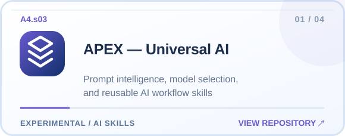
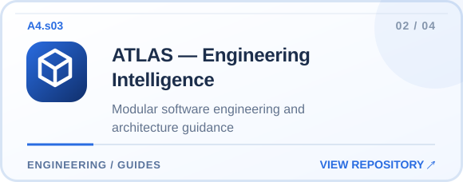
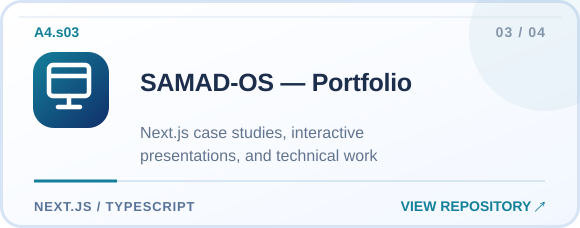
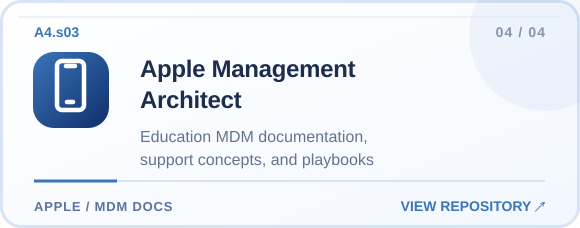

<!-- A4.s03: One GitHub-native profile, one separate portfolio website.
Source files and projects remain public; confidential employer and student records are excluded. -->

  

  <strong>Business Development · IT Infrastructure · Workflow Automation · AI Tooling</strong>
   
  Building useful systems, improving operations, and turning ideas into working tools.

  <a href="https://my-samad-portfolio.vercel.app/"><strong>Portfolio &amp; Case Studies</strong></a>
  &nbsp;·&nbsp;
  <a href="https://www.linkedin.com/in/abdul-samad-babillail-3bb342249/">LinkedIn</a>
  &nbsp;·&nbsp;
  <a href="https://github.com/Asbabillail?tab=repositories">All Repositories</a>

---

### About me

I'm **Abdul Samad Babillail**, an IT operations and technology professional based in Saudi Arabia. My work connects **business requirements with technical delivery**—supporting enterprise and education technology, coordinating infrastructure work, and developing practical automation and AI-tooling projects.

I approach technology by understanding the problem, choosing maintainable solutions, documenting the work, and improving how people use systems.

### Featured engineering projects

<table>
<tr>
<td width="50%">
  
</td>
<td width="50%">
  
</td>
</tr>
<tr>
<td width="50%">
  
</td>
<td width="50%">
  
</td>
</tr>
</table>

**Project maturity:** APEX and ATLAS are evolving AI and engineering skills frameworks. Apple Management Architect is a documentation preview without live device-command integration. SAMAD-OS contains public portfolio work and illustrative demos.

### Areas of work

| Domain | Technologies and responsibilities |
| :--- | :--- |
| **Business development** | Requirements, technical proposals, vendor coordination, solution evaluation and implementation follow-up |
| **Infrastructure** | Microsoft 365, Entra ID, Cisco networking, Fortinet, smart-classroom and workplace systems |
| **Device management** | Apple School Manager, Jamf, Microsoft Intune, deployment and device lifecycle support |
| **Automation & software** | Python, Streamlit, Next.js, TypeScript, React, Supabase and GitHub workflows |
| **AI tooling** | Reusable prompt and engineering skills, documentation, evaluation and permission-aware workflows |

My work also includes institutional account administration, ICT environments, operational handovers and education-technology coordination. **Detailed case studies and demonstrations belong on my [portfolio](https://my-samad-portfolio.vercel.app/).** Confidential employer and student information stays private.

---

### Course Completion & Certifications

My professional certifications, courses, training and simulations are presented as original certificate image previews. **Click any picture for a larger view.**

| | |
| :---: | :---: |
|  <b>Technical Consulting Virtual Internship</b> SAP / Forage virtual job simulation |  <b>Google Certified Educator — Level 1</b> Google for Education certification; valid through February 2029 |
|  <b>Data Science with Python</b> Simplilearn course completion |  <b>CCNA 200-301 Network Fundamentals</b> Simplilearn course — not Cisco CCNA certification |
|  <b>Introduction to Data Visualization</b> Simplilearn course completion |  <b>STEM Nexus professional development</b> STEM and education professional-development attendance certificate |
|  <b>Hikvision HCSA-Alarm</b> Hikvision Certified Security Associate — certificate expired April 2026 |  <b>Microsoft Excel for Data Analysis</b> Udemy course completion |
|  <b>IP Addressing &amp; Subnetting — Zero to Hero</b> Udemy course completion |  <b>Computer Networks Fundamentals</b> Udemy course completion |
|  <b>Windows 10 Complete Course</b> Udemy course completion |  <b>C++ Complete Training for Beginners</b> Udemy course completion |
|  <b>CSS Complete Course for Beginners</b> Udemy course completion |  <b>Primavera P6 Planning &amp; Scheduling</b> Udemy course completion |
|  <b>Instagram Marketing 2023</b> Udemy course completion |  <b>Amazon SEO &amp; Sales Funnels</b> Udemy course completion |
|  <b>SMART MX-V5 Display with iQ 4</b> SMART Technologies professional development course |  <b>AI Masterclass</b> Dhruv Rathee Academy participation certificate |

### Appreciation

Certificates recognizing contributions and professional participation.

| | |
| :---: | :---: |
|  <b>SMART Technologies — Appreciation</b> Certificate of appreciation, 2025 |  <b>Yenepoya International School — Appreciation</b> Certificate of appreciation, 2025 |

These are optimized image previews of the actual documents, with verification identifiers obscured where present. **SAP/Forage is a virtual job simulation; Simplilearn SkillUp and Udemy entries are course completions, not vendor professional certifications.** The Hikvision HCSA-Alarm certification expired in April 2026.

### Currently exploring

Maintainable IT operations, reliable device lifecycles, safe automation and AI-assisted engineering—distinguishing proposals, prototypes and verified results.

---

  <strong>A4.s03</strong> · Abdul Samad Babillail
   
  <a href="https://my-samad-portfolio.vercel.app/">Portfolio</a> &nbsp;·&nbsp;
  <a href="https://www.linkedin.com/in/abdul-samad-babillail-3bb342249/">LinkedIn</a> &nbsp;·&nbsp;
  <a href="https://github.com/Asbabillail?tab=repositories">GitHub Projects</a>

No private infrastructure diagrams, passwords, certificate identifiers, confidential pricing, or invented contribution statistics. GitHub supplies my actual activity calendar below the README.
